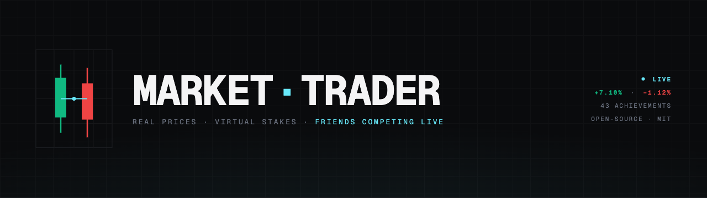
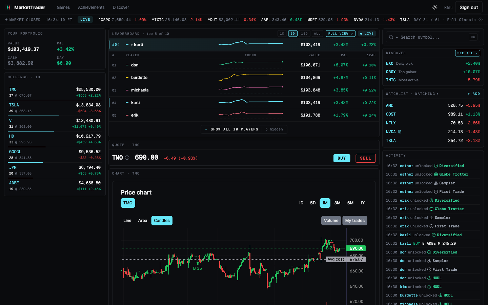
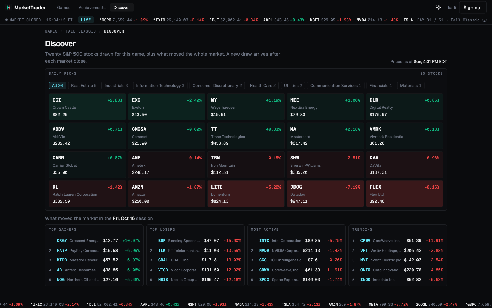
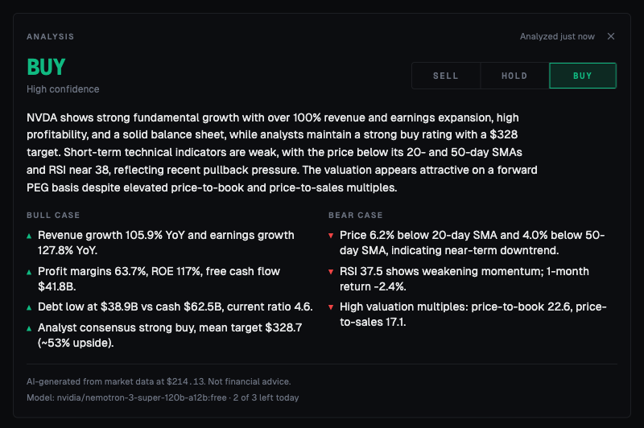
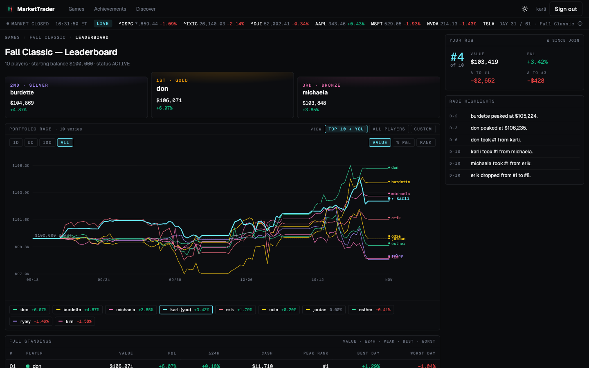
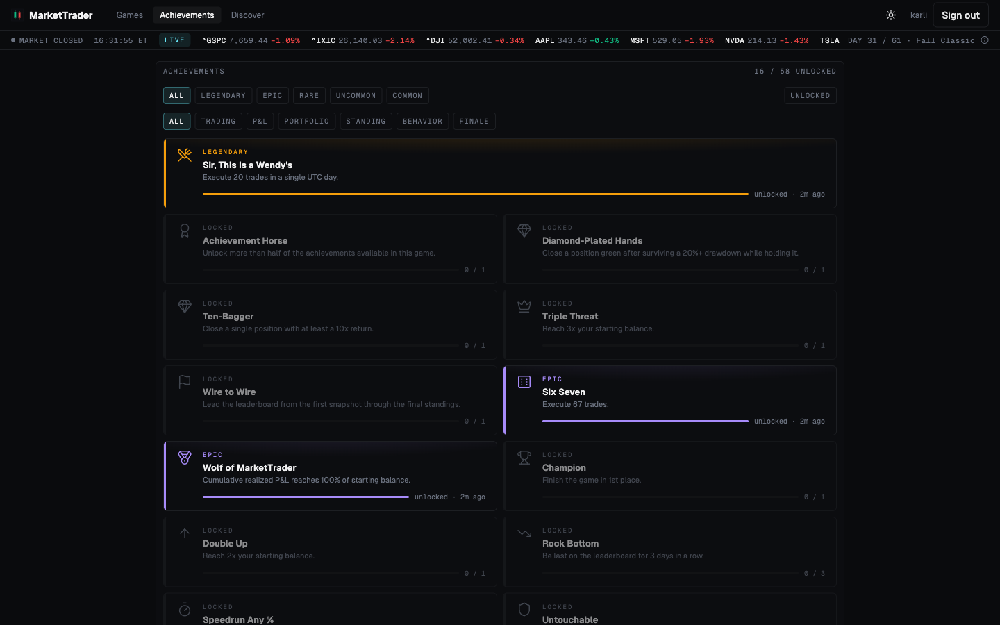

# MarketTrader

A virtual stock trading tournament platform. Groups of friends create a **game**, start with equal virtual cash, and compete to build the most valuable portfolio by trading real stocks at real market prices. A real-time leaderboard tracks rankings throughout the game.



> **AI disclaimer.** This project is being developed entirely by an AI (Claude Code). Each commit generated by Claude is signed by Claude. It received minimal human supervision. Use at your own risk as I make no guarantee about the correctness, security, or reliability of the codebase.

## Features

**Games**

- Create public or private tournaments, share them with an invite link, or browse open public games
- Per-game rules: starting balance, duration, allowed order types, GTC on/off, achievements on/off
- Featured-game leaderboards on the login page, visible without an account

**Trading**

- Market, limit, stop, stop-limit, and bracket (take-profit + stop-loss) orders, day or GTC
- Market-hours aware: orders placed while the market is closed settle at the next open
- Live portfolio value and P&L, plus full trade history

**Research**

- Candlestick or line charts with volume and markers for your own trades
- **Discover** page: daily S&P 500 picks per game, plus top gainers, losers, most active, and trending
- **AI analysis** (optional): one click returns a BUY / HOLD / SELL verdict with bull and bear points, generated server-side through OpenRouter and cached for every player
- Watchlists with free-form per-symbol notes; symbol search and a detail page per ticker

**Compete**

- Live leaderboard over WebSocket, with per-player sparklines and a full page with race chart and podium
- [Unlockable achievements](docs/achievements.md) across five rarity tiers, with progress tracking toward each one and an unlock toast when you earn it
- Activity feed of trades and peer unlocks in the arena's right rail

**Operate**

- Admin panel: users, games, portfolios, trade audit log, achievement grants and resets, system stats
- Live configuration: change cache TTLs, worker intervals, throttles and caps from `/admin/config` without a restart
- Per-user abuse limits (rates, quotas, socket caps) with overrides, probation for new accounts, and a usage dashboard
- Optional OpenTelemetry traces/metrics/logs and PostHog analytics. Both are off unless configured
- Light and dark themes, responsive layout, `prefers-reduced-motion` honored throughout

## Tour

> Screenshots may lag behind the latest UI. Run `pnpm dev` and click around to see the live version.

### Arena



_The main trading view. Portfolio and holdings are on the left. The leaderboard, quote and chart sit in the center, with candlesticks, volume, your buys and your average cost. Discover picks, the watchlist and the activity feed are on the right._

### Discover



_Twenty S&P 500 stocks drawn for this game each session, plus the previous session's top gainers, losers, most active, and trending._

### AI analysis



_One click on **Analyze** returns a verdict with a summary and bull and bear points. A cached result is free for every other player who asks._

### Leaderboard



_The race chart traces every player's portfolio value over the game. The podium pins the top three, and the standings carry inline sparklines._

### Achievements



_Unlocked cards glow in their rarity color. Locked ones show what's needed and how far along you are, filterable by rarity and category._

## Getting Started

**Prerequisites:** Node.js 26+ (`nvm use` reads `.nvmrc`), and pnpm via Corepack (`npm install -g corepack && corepack enable`). Corepack no longer ships with Node 26.

```bash
pnpm install
pnpm dev
```

`pnpm dev` creates `.env` from `.env.example` if it is missing and generates a real `JWT_SECRET`. It then starts the server on `:3000` and the frontend on `:5173`. The frontend proxies `/api` to the server. The default database is SQLite at `./dev.db`, and pending migrations run at startup.

**Your admin account.** On a database with no administrator, the server creates an `admin` account and prints its random password to the console once. Grab it from the `pnpm dev` output. Registering through the app never grants admin rights. Add further admins from the admin panel.

**PostgreSQL instead:** `docker-compose up`. See [`docs/deployment.md`](docs/deployment.md) for the full Docker/Postgres path.

### Common commands

```bash
pnpm test                         # all packages (in-memory SQLite, no setup)
pnpm --filter server test:watch   # watch mode for one package
pnpm typecheck
pnpm lint
pnpm e2e                          # Playwright end-to-end suite
pnpm build                        # production build
pnpm seed:history                 # generate fake game history to look at
```

To regenerate [`docs/achievements.md`](docs/achievements.md) and its preview images, run `pnpm dev`, then:

```bash
DOCS_ADMIN_USER=… DOCS_ADMIN_PASSWORD=… pnpm docs:achievements
```

## Configuration

The variables you're most likely to set:

| Variable                                      | Default                 | Description                                                                          |
| --------------------------------------------- | ----------------------- | ------------------------------------------------------------------------------------ |
| `DATABASE_URL`                                | `./dev.db`              | SQLite path or `postgres://...` URL                                                  |
| `JWT_SECRET`                                  | —                       | **Required**, ≥ 32 chars. `pnpm dev` generates one; otherwise `openssl rand -hex 32` |
| `PORT`                                        | `3000`                  | HTTP server port                                                                     |
| `CORS_ORIGIN`                                 | `http://localhost:5173` | Allowed frontend origin (must be set in production)                                  |
| `STOCK_PROVIDER`                              | `yahoo`                 | `yahoo` (no key needed), `alpaca`, or `mock`                                         |
| `ALPACA_API_KEY_ID` / `ALPACA_API_SECRET_KEY` | —                       | Required when `STOCK_PROVIDER=alpaca`                                                |
| `OPENROUTER_API_KEY`                          | —                       | Turns on AI stock analysis. Unset means the feature is off                           |
| `TRUST_PROXY`                                 | `loopback`              | Which proxy hops may set `X-Forwarded-For`. `true` is refused in production          |
| `OTEL_EXPORTER_OTLP_ENDPOINT`                 | —                       | OTLP/HTTP collector. Unset means no telemetry                                        |
| `POSTHOG_KEY` / `POSTHOG_HOST`                | —                       | Server-side PostHog. `VITE_POSTHOG_*` is the frontend equivalent                     |

[`.env.example`](.env.example) documents every option. Many of them can also be changed at runtime from the admin panel's **Configuration** page, which shows each option's effective value and where it came from.

## Architecture

```
packages/
  server/     ← Fastify 5 REST API + WebSocket server, background workers
  frontend/   ← React 19 + Vite SPA
  shared/     ← API contracts shared by server and frontend
tools/        ← fake-history generator, logo assets
```

A pnpm workspace monorepo. Every API type lives in `shared`, so a change to the API surface fails typecheck on both sides before it reaches runtime.

| Layer         | Choice                                                            |
| ------------- | ----------------------------------------------------------------- |
| Server        | Fastify 5, `@fastify/websocket`, Drizzle ORM                      |
| Database      | SQLite (dev, tests, single-host prod) or PostgreSQL               |
| Auth          | 15-min JWT access tokens + 7-day HttpOnly refresh cookies, argon2 |
| Frontend      | React 19, Vite, ShadCN/UI + Tailwind CSS                          |
| State         | React Query v5 (server), Zustand (client)                         |
| Charts        | TradingView Lightweight Charts                                    |
| Market data   | Pluggable `StockProvider` (Yahoo Finance default, Alpaca)         |
| LLM           | OpenRouter, server-side only                                      |
| Observability | OpenTelemetry + PostHog                                           |
| Code scanning | CodeQL with project-specific invariant queries                    |

The reasoning behind each choice is in [`docs/technical-decisions.md`](docs/technical-decisions.md).

## Releasing

The app has **one version**. `server`, `frontend`, and `shared` move together as a changesets `fixed` group, and `GET /api/version` reports it.

```bash
pnpm changeset            # with each change: describe it, commit the .changeset/*.md file
pnpm changeset version    # at release time: bump all three, write CHANGELOGs
git commit -am "release: vX.Y.Z"
pnpm release:tag          # bare vX.Y.Z tag (not `changeset tag`)
git push --follow-tags    # push before deploying: deployment builds from origin
```

Run the steps in that order: `release:tag` reads the version from the committed `packages/server/package.json`. Never run `pnpm changeset publish`, since nothing here goes to a registry. Cutting a version deploys nothing, and deploying changes no version. See [`.changeset/README.md`](.changeset/README.md) and ADR-014 for the details.

## Documentation

- [`docs/design.md`](docs/design.md): features, data model, and known gaps
- [`docs/technical-decisions.md`](docs/technical-decisions.md): the ADR log. Read it before swapping a library or pattern
- [`docs/achievements.md`](docs/achievements.md): every achievement with a preview image
- [`docs/deployment.md`](docs/deployment.md): the Docker/Postgres deployment path
- [`docs/observability.md`](docs/observability.md): metric catalogue and instrumentation
- [`docs/codeql.md`](docs/codeql.md): the custom CodeQL invariant queries
- [`docs/pii-inventory.md`](docs/pii-inventory.md): every piece of personal data stored
